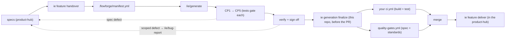

# Intent Engineering SDLC — Code Repo Workflow

> Generation guide for this code repository. The always-loaded context is [`../CLAUDE.md`](../CLAUDE.md). Specs live upstream in the product-hub; code here is generated from them. Per-command detail: [`generate.md`](../.claude/commands/ie/generate.md), [`bug-report.md`](../.claude/commands/ie/bug-report.md) and [`apply-improvement.md`](../.claude/commands/ie/apply-improvement.md).

## How code gets here



## The generation loop (`/ie/generate`)

| Checkpoint | Produces |
|-----------|----------|
| **CP1 Domain Model & Contracts** | Data models, schemas, event/API/message contracts, repo interfaces |
| **CP2 Domain Logic & Rules** | Domain services, validation, business logic, state machines |
| **CP3 Interface Layer** | API endpoints, event handlers, middleware |
| **CP4 Presentation** *(optional)* | UI components, pages, design-token application |
| **CP5 Deployment Topology** | IaC, CI/CD config, deployment manifests |

Tests gate every checkpoint — don't skip ahead. Generation appends judgment calls to `.flowforge/trace.yml`.

## Before you can generate (foundation gates)

`/ie/generate` hard-blocks until the required gates pass for every touched service:

`repo_exists` · `flowforge_initialized` · `workspace_registered` · `ci_configured`

Check from the product-hub: `ie service status <id>`. Attest CI (also from the product-hub) with `ie service init <id> --path <checkout> --ci-configured`.

`ci_configured` means **this repo has its own build and test CI, and its checks are required on the integration branch** — see [Your own build and test CI](#your-own-build-and-test-ci). The IE-managed `quality-gates.yml` does not satisfy it: that workflow checks spec alignment and runs no build or tests.

## Pointers

- **What to build this run** → `.flowforge/manifest.yml` (assembled + sliced per repo by the hub), plus `.flowforge/hub/`, the copy handover made of every hub file the manifest names. `/ie/generate` and `/ie/apply-improvement` read specs, screens and standards from that copy, so a hub change after handover reaches this repo only through `ie feature handover --refresh`.
- **Where the product-hub lives** → `.ie/hub.yml` (per-machine pointer written by `ie feature handover`; gitignored, never committed). Resolve + validate it with **`ie hub path`** (the deterministic primitive `/ie/generate` uses to reach the hub for its workspace checks and its writes). Missing or stale? Re-run `ie feature handover` from your product-hub checkout.
- **Generate** → `/ie/generate` ([detail](../.claude/commands/ie/generate.md)) in Claude Code. In **GitHub Copilot CLI** the same step is `copilot --agent ie-generate` (or pick `ie-generate` from `/agent`) — one verb, native gesture per runtime. The hub enables runtimes; this repo receives the matching agent files via `ie service init` / `ie update --code-repos`.
- **Finish the run** → **`ie generation finalize`**, in this repo, on the feature branch, **before you open the PR**. No id needed — the manifest names the feature. It moves `.flowforge/manifest.yml`, the checkpoint results and the generation logs into `.flowforge/archive/{feature-id}/` and removes the `.flowforge/hub/` copy without archiving it, so the integration branch never carries live generation state and the PR still shows the audit trail. It resolves no product-hub, so it works offline and in a clone with no workspace. If review sends the work back, **`ie generation finalize --revert`** reverts the finalize commit, which restores everything including `.flowforge/hub/` and keeps any commit you made after finalize (`/ie/generate --resume`, `ie feature handover --refresh` and `/ie/bug-report` all key off the root manifest) — refused once the finalize commit has merged. `quality-gates.yml` comments on the PR when the root manifest is still there, so the reviewer sees it too.
- **Generation metrics** → `.flowforge/metrics.yml`, written by `ie generation init`, `ie generation update` and `ie metrics record --repo .`, which `/ie/generate` and `/ie/apply-improvement` run for you. It counts transitions into `blocked`, `checkpoint_failed` and `failed`, holds each review verdict, and holds the model tokens of each `/ie/generate`, `/ie/bug-report` and `/ie/apply-improvement` run, which `ie usage record` reads from the Claude Code session at the run's start, gates and close. The close comes before `ie generation finalize`, so the tokens are committed and archived with the rest. Close any workflow still open in the product-hub before running these in the same Claude Code session, or the hub's record counts this repo's tokens too. Commit it with the other `.flowforge/` files, and never edit it or `generation-status.yml` by hand: a hand edit loses the count. While it still holds the counts of an earlier feature that was never finalized, `ie generation init` refuses to start and says how to clear it. `ie generation finalize` archives it, and delivery in the hub (`ie feature deliver`, `ie fix deliver` or `ie imp deliver`) copies it into the metrics trail there. It names no person.
- **Apply a technical improvement** → `/ie/apply-improvement` ([detail](../.claude/commands/ie/apply-improvement.md)), after `ie imp handover` in the hub. This is the code side of a technical change that alters no behaviour. The manifest's `shape` says which of three it is, and the code side branches on it: **substitution** (a technology retired — an engine, a datetime representation, a client library) inventories the occurrences and proves the old one gone; **optimization** re-measures the `metric` baseline and clears the bar; **qualitative** runs the `invariant` check failing, then holding. It is a separate command from `/ie/generate`, which refuses an `IMP` manifest by name: the five checkpoints derive from a use case, a contract and a screen, and an improvement carries none of the three. It moves this repo from the manifest's `current_state` to its `target_state` and verifies with this repo's existing gates **plus the shape's witness** — a green suite that never exercised the changed surface is green for the wrong reason. `ie generation finalize` before the PR, as usual.
- **Fix defects upstream** — patch the spec in the product-hub and regenerate; never hand-patch generated code. For a defect in the feature currently in flight, before finalize, run `/ie/bug-report` from this repo ([detail](../.claude/commands/ie/bug-report.md)) instead of a full re-shape — it diagnoses, classifies, patches the spec, and regenerates from only the invalidated checkpoint. After finalize, bug-report refuses by construction (the root manifest is gone) and tells you which way out applies: `--revert` while the PR is open, or the hub's delivery + post-delivery fix rail once it has merged. That rail is `/ie/fix-defect`, run from the hub. A `delivered`/`archived` feature is refused here however this repo's manifest looks.
- **After the merge** — the operator records the delivery in the product-hub (`ie feature deliver <id>`): the feature's status, its spec seals and the promotion credit all land there, gated on this repo's archive being present on the integration branch. Nothing is expected of this repo after the merge.

## Staying current

The IE-managed files in this repo — `.github/workflows/quality-gates.yml`, `docs/WORKFLOW.md`, `.claude/commands/ie/generate.md`, `.claude/commands/ie/bug-report.md` — are refreshed from the operator's product-hub with `ie update --code-repos`. It overwrites only files you have **not** edited; a locally-edited file is held and reported (re-run with `--force` to take the scaffold version). Changes arrive in your working tree — review and commit them like any change. Your `CLAUDE.md` is yours and is never touched, and so is your own `ci.yml` — IE neither ships nor syncs it.

## Your own build and test CI

Intent Engineering ships **one** workflow to this repo: `quality-gates.yml`. It checks that the code still matches the specs it was generated from — spec drift, Gherkin coverage, contract validation, contract operation coverage, standards alerts. It runs **no build, no tests, no linter, no security scanner**, and it never invokes your npm or Gradle scripts. It cannot: it does not know your stack, your test runner, or what your suites need in order to run.

**Building and testing this repo is yours.** Author your own workflow next to it — `ci.yml` is the conventional name — and make its checks **required on the integration branch**. Branch protection, not `quality-gates.yml`, is what guarantees the code compiles and its tests pass before a merge — `quality-gates.yml` asserts spec alignment only, and speaks for nothing else.

A Node starting point:

```yaml
name: CI

on:
  push:
    branches: [main]
  pull_request:

concurrency:
  group: ci-${{ github.ref }}
  cancel-in-progress: true

jobs:
  ci:
    runs-on: ubuntu-latest
    steps:
      - uses: actions/checkout@v5
      - uses: actions/setup-node@v5
        with:
          node-version: '22'
          cache: npm

      - run: npm ci
      - run: npm run lint
      - run: npm run typecheck
      - run: npm test
      - run: npm run build

      # Scope the audit to what ships. devDependencies — linters, test runners,
      # codegen — do not reach a runtime image, and their advisories are often
      # unfixable from inside this repo: a vulnerable transitive pinned by a
      # toolchain package has no forward fix until that package updates, so
      # auditing the dev tree turns a blocking gate permanently red with nothing
      # you can do about it. A Next.js repo hits this immediately.
      - run: npm audit --audit-level=high --omit=dev

      # Browser suites need browsers. Install every project your
      # playwright.config declares — naming one (`... install chromium`) is the
      # usual way this breaks: a webkit project then fails with
      # "Executable doesn't exist at .../ms-playwright/webkit-*/pw_run.sh".
      - name: Install Playwright browsers
        if: hashFiles('playwright.config.*') != ''
        run: npx playwright install --with-deps

      - run: npm run test:e2e --if-present
      - run: npm run test:a11y --if-present
```

Swap the Node steps for `mvn verify` / `./gradlew build` on a JVM service. Keep whatever your project actually needs — this is an example, not a contract. The one real contract is [STD-035](../standards/general/STD-035-scenario-key-binding.md): tests carry scenario keys in their names and the runner writes JUnit XML.

Alternatively, keep browser provisioning inside the script itself — `"pretest:e2e": "playwright install --with-deps"` — so `npm run test:e2e` works identically in CI and on a laptop. npm runs `pre<script>` automatically.

## CI configuration

The `quality-gates.yml` workflow reads a few repo/org settings. Most have safe fallbacks — this table marks what you actually need.

| Setting | Kind | Needed when | Purpose |
|---|---|---|---|
| `PRODUCT_HUB_TOKEN` | Secret | Hub is a private repo (the normal case) | Lets CI **read the product-hub** (spec-drift, Gherkin coverage, standards scan). Classic PAT with `repo` scope that can reach the hub — the `GITHUB_TOKEN` fallback can't read a *different* repo, so a private hub needs this. |
| `IE_CLI_PACKAGES_TOKEN` | Secret | Hub lives in a different org than `rp-flow` | Installs `@rp-flow/ie-cli` (used by spec-drift). Classic PAT with `read:packages` on `rp-flow` (fine-grained PATs don't support Packages; use a bot account to limit blast radius). Same-org falls back to `GITHUB_TOKEN`. Missing it only downgrades spec-drift to a skip. |
| `PRODUCT_HUB_REPO` | Variable | **Legacy manifests only** (no `product_hub_remote`) **and** the hub isn't at `{owner}/product-hub` | Names the hub as `owner/name`. Manifests from `ie feature handover` carry `product_hub_remote` and this variable is ignored. Regenerate the handover to retire it. |
| `SPEC_DRIFT_BLOCKING` | Variable | You want drift to fail the build | Default is warn-only; set `true` to fail the job on spec drift. |

**Where to set them.** A cross-org hub (a hub in a different org than this repo) needs `PRODUCT_HUB_TOKEN` and `IE_CLI_PACKAGES_TOKEN` as **organization** Actions secrets (Settings → Secrets and variables → Actions → New organization secret, scoped to all repos) so every service inherits them. A same-org *private* hub still needs `PRODUCT_HUB_TOKEN`.

**Container and dependency scanning** is yours, in your own workflow (see above) — `quality-gates.yml` runs no scanners. Keep base images and dependencies patched.

## Spec-drift detection (CI)

CI recomputes each manifest spec's hash from the product-hub and compares it to the pinned `spec_hash`. If the hub specs moved since handover, the PR is annotated per drifted spec (warn-only by default; set the `SPEC_DRIFT_BLOCKING` repo/org variable to `true` to fail the job). While the feature is in flight this is expected: the hub's integration branch moves with other features' work, and this repo stays on the hub commit it was handed over from. A correction to this feature's own specs goes through `/ie/bug-report`, whose re-handover runs from the feature's bug-report branch and refuses to bring other features' changes in. A plain `ie feature handover --refresh` is not checked this way: it reads every spec from the hub branch you run it on. Run it only from a hub branch that brings in no spec changes since the handover other than this feature's own. Run from the integration branch, it takes in every other feature's changes too. Run the check yourself any time with `ie manifest verify` — from a handed-over repo it resolves the hub from `.ie/hub.yml`; pass `--hub <path-to-product-hub>` to override (CI always does).
